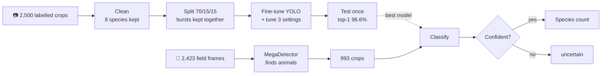
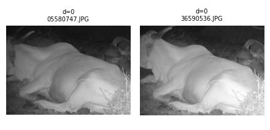
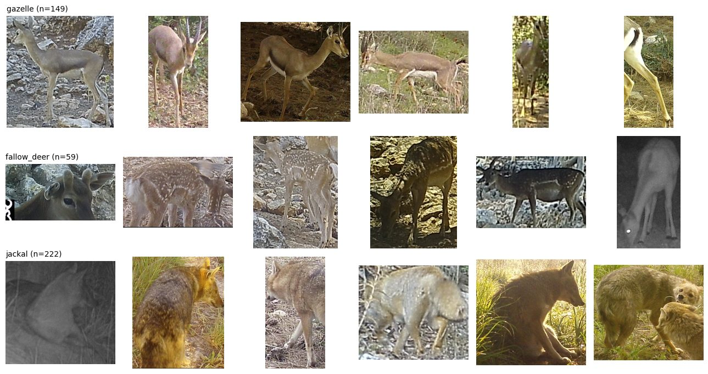
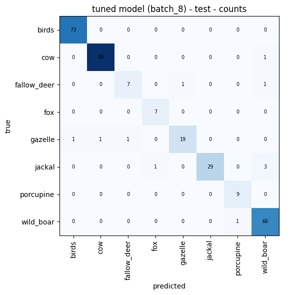
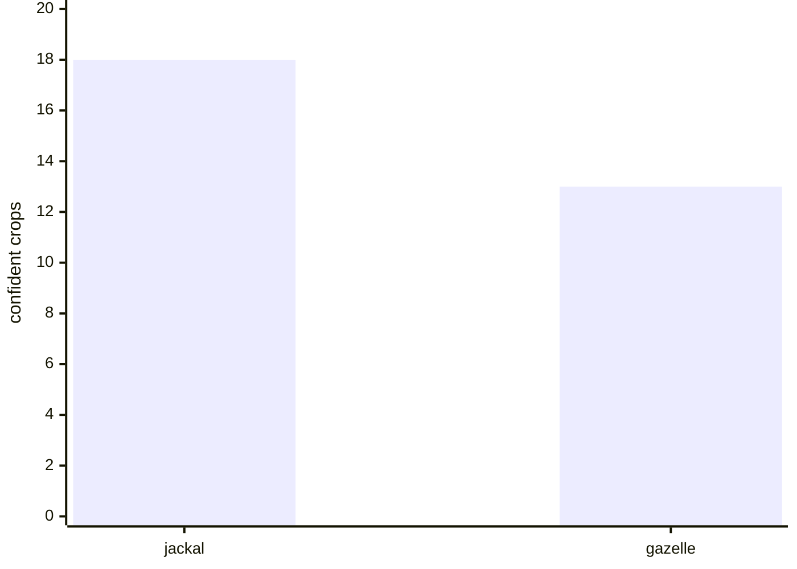

# Detect-Species

## Background

We were asked to train and validate an image model that identifies animal species in camera-trap photos, then use it to count which species appear in a month of new, unlabelled field footage (May 2022). The key question: do jackals (predators) outnumber gazelles (prey)?

## How it works

## Three problems the pipeline handles

**1. Burst frames.** Camera traps fire several near-identical shots. If one lands in train and its twin in test, the test score is inflated. Near-duplicates are therefore kept together in one split.

**2. Look-alikes.** Gazelle (top row) and fallow deer (middle row) mostly differ by the deer's spots and antlers. Jackal (bottom row) is the predator they're compared with.

**3. Animals the model was never trained on.** A classifier always picks one of its species, even for an empty box or a hyena. Crops scored below 82% confidence are set aside as `uncertain`.

## Results

**Test set:** 309 of 320 images correct, and gazelle is never confused with jackal.

**May 2022 field data:** of 993 animal crops, jackal outnumbers gazelle.

The rest are wild boar (457), birds (228), other species (73) and uncertain (204).

---
Code: [`pipeline.py`](pipeline.py), five steps that read top to bottom. Run it with `pip install -r requirements.txt && python pipeline.py`.
